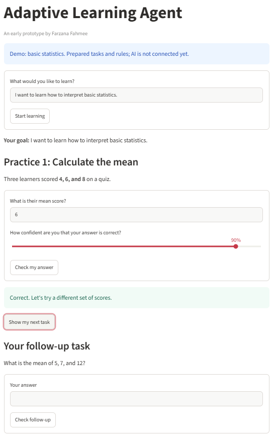
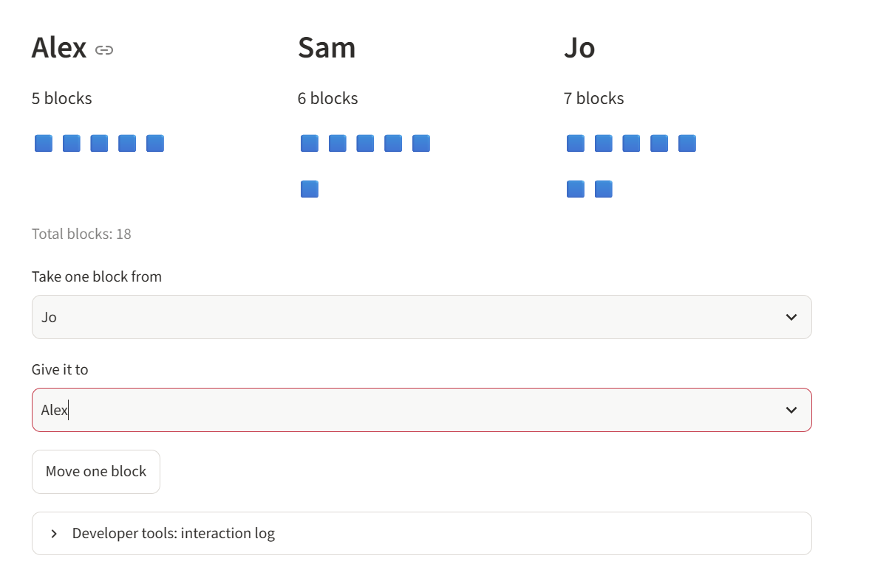

# Adaptive Learning Agent

A Python and Streamlit prototype that explores how a learner’s answer
and confidence can guide the next step in a lesson on the mean.

## Two demos

- **Statistics practice (`app.py`)** uses answer correctness and
  self-reported confidence to choose a follow-up question.
- **Sharing Detectives (`child_app.py`)** uses movable blocks to teach
  the mean through equal sharing. Learners check their reasoning after
  answering correctly. The demo can export a session log as JSON.

## Run locally
## Demo screenshots

**Statistics practice**



**Sharing Detectives**



Use Python 3.12. Open a terminal in the project folder and install
Streamlit:

```bash
python -m pip install streamlit
```

Run either demo:

```bash
python -m streamlit run app.py
```

```bash
python -m streamlit run child_app.py
```

Open the local URL printed in the terminal. Press Ctrl+C to stop
the running demo before starting the other one.

## Try the visual demo

In Challenge 1, enter `7` to reveal the visual help. Move two blocks
from Jo to Alex to create three equal groups, then enter `6` and
choose the equal-sharing explanation. Open **Developer tools:
interaction log** to inspect and download the recorded events.

## Project status

Both demos use prepared questions and rule-based feedback.
The visual demo has been manually tested through both challenges.
Learning outcomes and usability with children remain to be evaluated.
